<picture>
  <source media="(prefers-color-scheme: dark)" srcset="assets/hero-dark.svg">
  
</picture>

  

  <a href="https://adityaxsr.is-a.dev"><picture><source media="(prefers-color-scheme: dark)" srcset="assets/pill-portfolio-dark.svg"></picture></a>
  <a href="https://linkedin.com/in/as0097"><picture><source media="(prefers-color-scheme: dark)" srcset="assets/pill-linkedin-dark.svg"></picture></a>
  <a href="mailto:adityaxsr@gmail.com"><picture><source media="(prefers-color-scheme: dark)" srcset="assets/pill-email-dark.svg"></picture></a>

## About

I'm a final-year computer science student who likes problems that cross layers. One request can touch a Jetson on a desk, a quantised model, an agent deciding which tool to call, and a product someone pays for.

My keenest interest is **multi-domain architecture**: drawing the boundaries so hardware, models, agents and product agree with each other. I write an ADR before every major architecture decision, and I measure what I ship: latency, loss, uptime, conversion.

## How the work spans domains

<picture>
  <source media="(prefers-color-scheme: dark)" srcset="assets/orbit-dark.svg">
  
</picture>

Each ring is a domain of my work. Inner rings are what I build on; outer rings are what I ship on.

## By the numbers

<picture>
  <source media="(prefers-color-scheme: dark)" srcset="assets/stats-dark.svg">
  
</picture>

Live from GitHub. Refreshed weekly by a scheduled Action, no manual updates.

<picture>
  <source media="(prefers-color-scheme: dark)" srcset="assets/divider-dark.svg">
  
</picture>

<i>Build at the edge. Think at the frontier.</i>

